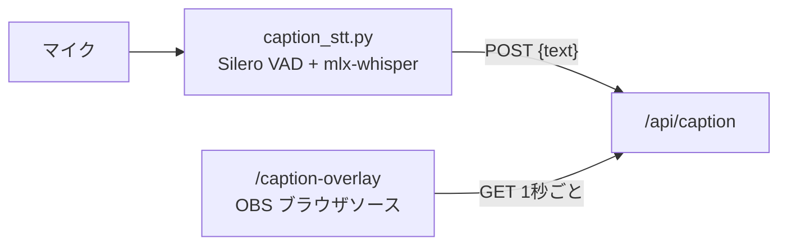
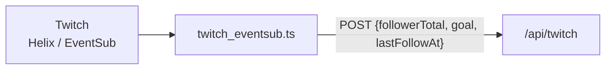

# Splatoon Point Counter

<p align="center">
  OBS向けのリアルタイム・データオーバーレイ・システム
</p>

<p align="center">
  
</p>

## 概要

**Splatoon Point Counter** は、ライブストリーミング（特にOBS Studioでの利用）をリッチにするためのリアルタイム・データオーバーレイ・システムです。Next.jsで構築されており、ストリーマーがコントロールパネルからスコアやメッセージ、各種データをリアルタイムで更新し、それを配信画面上のオーバーレイに反映させることができます。

## 主な機能

本システムは、主に以下の6つの画面と Twitch 連携で構成されています。

### 1. ランチャー

アプリケーションの起点となるページです。ここからコントロールパネルや各オーバーレイ画面を新しいタブで開くことができます。


### 2. コントロールパネル

ストリーマーがオーバーレイに表示するデータを操作するための管理画面です。タブ形式で各機能を直感的にコントロールできます。

- **スコア表示**: メインスコアのラベルや値を更新します。
- **バーンダウン**: 目標値に対する進捗（例: ポイント、視聴者数など）を管理します。
- **メッセージ**: オーバーレイに表示するスクロールメッセージを複数プリセットから選択・管理します。
- **サイドパネル**: フォロワーゲージの目標（手入力）、本日のお題の追加・達成チェック、サイドパネルオーバーレイの固定枠・ローテーション枠に表示するスロットと、ローテーションの切り替え秒数を設定します。
- **テロップ**: 実況テロップのプリセット（「ナイス!」など）をボタンかキーボードの 1〜9, 0 で配信画面に出します。自由入力の文も出せます。プリセットの追加・並べ替え・削除はその場で保存されます。
- **サーモンラン**: バイトごとの金イクラ納品数・オオモノ処理数・デス数・クリア/失敗を記録し、「前回」と「本日（配信セッション）合計」を集計します。記録は SQLite（`data/overlay.db`）に保存されるため、再起動後も過去のセッションを参照できます。
- **共通設定**: オーバーレイ全体のフォントや、音声認識によるエフェクト（「ナイス！」などのキーワードでハートを表示）の有効/無効を切り替えます。


### 3. スコア＆メッセージオーバーレイ

コントロールパネルで設定されたスコアとメッセージを配信画面に表示するためのオーバーレイです。OBSのブラウザソースにURLを指定して使用します。


### 4. バーンダウンチャートオーバーレイ

特定の目標（例: 配信時間、目標登録者数）に対する進捗をグラフとプログレスバーで可視化する専用オーバーレイです。目標達成時には花火のエフェクトが表示されます。


### 5. 字幕オーバーレイ

配信者の声をリアルタイムに文字起こしし、字幕として表示するオーバーレイです（`/caption-overlay`）。背景は透過で、直近8秒以内の字幕を最大2行表示します。

文字起こしは Apple Silicon Mac 上で動く Python スクリプト（`tools/caption-stt/`）が行い、`/api/caption` に字幕を送信します。



### 6. サイドパネルオーバーレイ

配信画面右側（250x584）に置くオーバーレイです（`/side-panel-overlay`）。上段にはフォロワー目標をインクタンク型のゲージで表示し、フォローされるとインクが波打ち、目標に届くと花火が上がります（Twitch 連携が必要。目標は Twitch のフォロワー目標を優先し、無ければコントロールパネルで手入力した値を使います）。下段に表示する内容（サーモンランのスケジュール / 本日の戦績（サーモンランの成績） / 本日のお題 / バーンダウン）は、コントロールパネルの「サイドパネル」タブで「固定枠」と「ローテーション枠」に振り分けます。固定枠に選んだものは上から順に常に表示し、その下の残りのスペースでローテーション枠に選んだものを一定時間ごとに1つずつ切り替えます（例: スケジュールを固定し、その下で本日の戦績と本日のお題を切り替える）。同じものを両方の枠に入れることはできず、バーンダウンを固定するときはそれ1つだけになります。本日のお題は、達成したものにスタンプが押されます。お題の入力で改行を入れると、配信画面でもその位置で折り返して表示します。スケジュールは、開催中のサーモンラン（ビッグラン・バイトチームコンテストを含む）のステージ・支給ブキ・残り時間を [spla3.yuu26.com](https://spla3.yuu26.com/) の非公式 API から自動で取得して表示します（5 分ごとに更新）。設定は SQLite に保存されるため、再起動後も保持されます。

OBS のブラウザソースには `http://localhost:3000/side-panel-overlay`（幅 250・高さ 584）を指定します。

### 7. 実況テロップオーバーレイ

コントロールパネルの「テロップ」タブで出した定型文を、インク風の帯で4秒ほど大きく表示するオーバーレイです（`/telop-overlay`）。サーモンラン中などチャットを打てないときの実況の代わりになり、配信映像にそのまま残ります。コントロールパネルにフォーカスがあるときは、キーボードの 1〜9, 0 でプリセットの上から順に出せます（入力欄にカーソルがあるときは効きません）。プリセットは SQLite に保存されます。

OBS のブラウザソースには `http://localhost:3000/telop-overlay`（幅 1920・高さ 1080）を指定します。

Stream Deck などから出すときは、`POST /api/telop` に `Content-Type: application/json` で `{"presetId": <プリセットの id>}` か `{"text": "<30 文字までの文>"}` を送ります。

```bash
curl -X POST http://localhost:3000/api/telop -H "Content-Type: application/json" -d '{"presetId": 1}'
```

### 8. Twitch 連携

Twitch のフォロワー数とフォロワー目標（クリエイターゴール）をリアルタイムに受信し、`/api/twitch` で提供します。受信は Node のスクリプト（`tools/twitch-eventsub/`）が EventSub WebSocket で行うため、公開 URL は不要です。フォロワーの名前は扱いません。




## 技術スタック

- **フレームワーク**: [Next.js](https://nextjs.org/) 14+ (App Router)
- **言語**: TypeScript
- **UI/スタイリング**: Material-UI (MUI), Tailwind CSS
- **リアルタイム通信**: REST API (クライアントからのポーリング)
- **永続化**: SQLite（Node 24 標準の [`node:sqlite`](https://nodejs.org/api/sqlite.html)。`data/overlay.db`、追加の依存なし）
- **テスト**: Vitest, React Testing Library
- **パッケージマネージャ**: [pnpm](https://pnpm.io/)
- **文字起こし**: [mlx-whisper](https://github.com/ml-explore/mlx-examples/tree/main/whisper) + [Silero VAD](https://github.com/snakers4/silero-vad)（Python 3.12、Apple Silicon Mac でネイティブ実行）
- **Twitch 連携**: [EventSub WebSocket](https://dev.twitch.tv/docs/eventsub/handling-websocket-events/) + [Device Code Flow](https://dev.twitch.tv/docs/authentication/getting-tokens-oauth/#device-code-grant-flow)（Node 24 標準の `fetch` / `WebSocket` で実行。追加の依存なし）
- **CI/CD**: GitHub Actions

## セットアップと起動方法

### ローカル環境での起動

本プロジェクトはパッケージマネージャに **pnpm** を使用します。未導入の場合は [Volta](https://volta.sh/)（`volta install pnpm`）または corepack（`corepack enable`）で準備してください。使用するバージョンは `package.json` の `packageManager` / `volta` フィールドで固定されています。

1.  依存関係をインストールします。
    ```bash
    pnpm install
    ```

2.  開発サーバーを起動します。
    ```bash
    pnpm dev
    ```

3.  ブラウザで `http://localhost:3000` を開きます。

### Dockerでの起動

1.  Dockerイメージをビルドします。
    ```bash
    docker-compose build
    ```

2.  コンテナを起動します。
    ```bash
    docker-compose up
    ```
3.  ブラウザで `http://localhost:3000` を開きます。

サーモンランの記録などのデータは `data/overlay.db`（SQLite）に保存されます。`docker-compose` はリポジトリをコンテナにマウントしているため、コンテナを作り直してもデータはホスト側に残ります。

> [!NOTE]
> `node_modules` は匿名ボリュームとしてマウントされるため、npm を使用していた頃のボリュームが残っていると古い依存関係がそのまま使われ続けます。pnpm 移行後に初めて起動する場合は、一度 `docker-compose down -v` でボリュームを破棄してからビルドし直してください。

### 字幕（文字起こし）の起動

Next.js アプリを起動した状態で、リポジトリのルートで次を実行します（`Ctrl+C` で終了）。初回は Python の venv 作成と依存のインストール、Whisper モデル（約 1.5GB）のダウンロードが自動で行われます。

```bash
pnpm caption
```

OBS のブラウザソースには `http://localhost:3000/caption-overlay` を指定します。マイクの変更などの詳細は [tools/caption-stt/README.md](tools/caption-stt/README.md) を参照してください。

### Twitch 連携の起動

Twitch Developer Console でアプリ（クライアントの種類: 公開）を登録し、クライアント ID を `.env.local` の `TWITCH_CLIENT_ID` に設定したうえで、Next.js アプリを起動した状態で次を実行します（`Ctrl+C` で終了）。初回はブラウザでの承認が必要です。

```bash
pnpm twitch
```

スクリプトは Docker の外（ホスト側）で実行します。アプリを `docker-compose up` で起動している場合も、そのまま `http://localhost:3000/api/twitch` に送信されます。

詳細は [tools/twitch-eventsub/README.md](tools/twitch-eventsub/README.md) を参照してください。

## CI/CD

このリポジトリでは、GitHub Actionsを利用してCI/CDパイプラインを構築しています。

- **CI (継続的インテグレーション)**: `main`または`staging`ブランチへのプルリクエスト時、および`main`ブランチへのプッシュ時に、Lintとテストが自動的に実行されます。
- **CD (継続的デリバリー)**: `main`ブランチへのマージをトリガーとして、Dockerイメージがビルドされ、Docker HubおよびGitHub Container Registryに自動的にプッシュされます。
