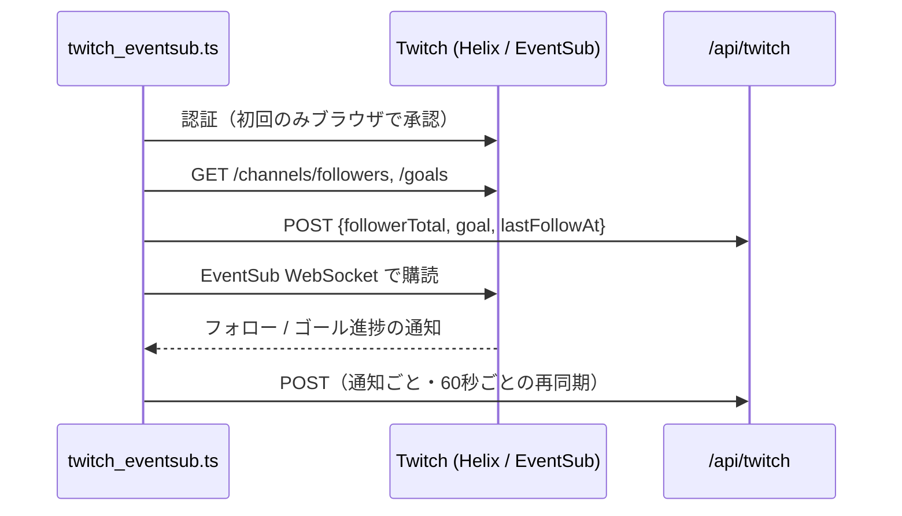

# twitch-eventsub

Twitch のフォロワー数とフォロワー目標（クリエイターゴール）をリアルタイムに受信し、アプリの `/api/twitch` へ送信する常駐スクリプトです。

- 受信: [EventSub WebSocket](https://dev.twitch.tv/docs/eventsub/handling-websocket-events/)（`channel.follow` v2、`channel.goal.begin` / `progress` / `end`）
- 認証: [Device Code Flow](https://dev.twitch.tv/docs/authentication/getting-tokens-oauth/#device-code-grant-flow)（リダイレクト用のサーバーや公開 URL が不要）
- 依存パッケージなし（Node 24 標準の `fetch` / `WebSocket` と型除去で動作）

フォロワーの名前はアプリに送信しません（人数と最後にフォローを受信した時刻のみ）。



## 初回セットアップ

1. [Twitch Developer Console](https://dev.twitch.tv/console/apps) でアプリを登録する
   - **OAuth のリダイレクト URL**: `http://localhost`（Device Code Flow では使わないが入力必須）
   - **カテゴリー**: 任意（例: Broadcaster Suite）
   - **クライアントの種類**: **公開**（Public）
2. 登録したアプリの **クライアント ID** を、リポジトリのルートの `.env.local` に書く

   ```bash
   TWITCH_CLIENT_ID=xxxxxxxxxxxxxxxxxxxxxxxxxxxxxx
   ```

## 使い方

1. Next.js アプリを起動する（`pnpm dev` または `docker-compose up`）
2. リポジトリのルートで起動する（`Ctrl+C` で終了）

   ```bash
   pnpm twitch
   ```

3. 初回は次のように表示されるので、ブラウザで URL を開き、コードを確認して **配信に使うアカウントで** 承認する

   ```
   [twitch] ブラウザで https://www.twitch.tv/activate?... を開き、コード ABCD-EFGH を確認して承認してください
   ```

承認後のトークンは `data/twitch-token.json`（Git 管理外・パーミッション 600）に保存され、次回以降は自動で再利用・更新されます。リフレッシュトークンが失効した場合（30 日間未使用など）は、再び承認を求められます。

`http://localhost:3000/api/twitch` を開くと、受信した内容を確認できます。

## 動作の詳細

- フォロー通知には総数が含まれないため、受信時は手元の値に 1 を加算し、60 秒ごとに Helix から総数を取り直して補正します（フォロー解除も定期同期で反映されます）
- 60 秒ごとの再同期では最新の状態を `/api/twitch` に送り直すため、Next.js を再起動しても 1 分以内に表示が戻ります
- WebSocket が切断された場合や keepalive が途絶えた場合は、待ち時間を伸ばしながら（最大 60 秒）再接続し、購読し直します。Twitch からの `session_reconnect` には購読を引き継いだまま接続先を切り替えます
- 購読が通信断や Twitch 側の一時的なエラー（5xx・429）で失敗した場合も、同じく再接続して購読し直します
- 購読が取り消された場合（アプリの連携解除など）や、再試行しても直らない理由（スコープ不足などの 4xx）で購読に失敗した場合は終了します
- 常駐中にトークンを更新できなくなった場合（リフレッシュトークンの失効など）は、ログに承認用のコードを表示して承認を待ちます

## 環境変数

| 変数 | 既定値 | 説明 |
|---|---|---|
| `TWITCH_CLIENT_ID` | （必須） | Twitch Developer Console で登録したアプリのクライアント ID |
| `TWITCH_API_URL` | `http://localhost:3000/api/twitch` | 送信先 |
| `TWITCH_TOKEN_PATH` | `data/twitch-token.json` | トークンの保存先 |

## テスト

アプリ本体と同じく Vitest で実行されます（CI 対象）。

```bash
pnpm exec vitest run tools/twitch-eventsub
```
