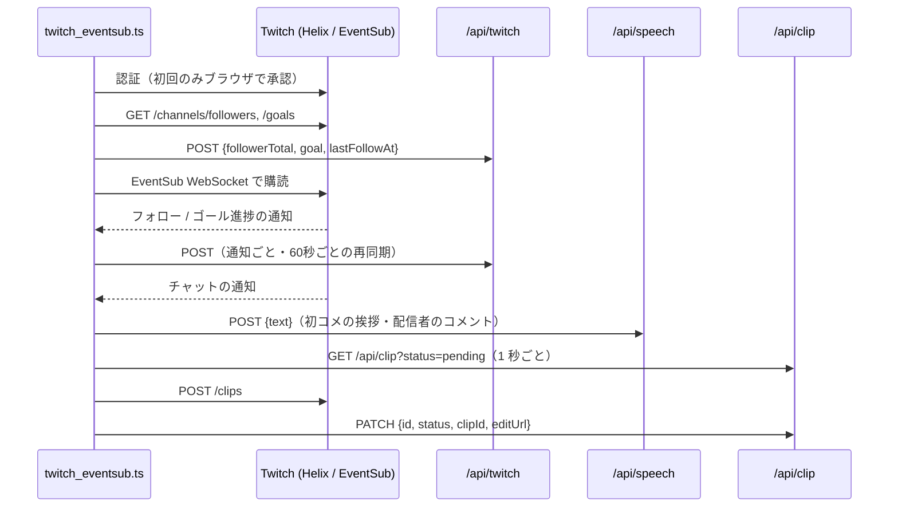

# twitch-eventsub

Twitch のフォロワー数とフォロワー目標（クリエイターゴール）をリアルタイムに受信し、アプリの `/api/twitch` へ送信する常駐スクリプトです。チャットも受信し、初めてコメントした視聴者への挨拶と配信者自身のコメントを、アプリの読み上げキュー（`/api/speech`）へ送ります。声やコントロールパネルのボタンで依頼された（`/api/clip`）Twitch のクリップも作ります。

- 受信: [EventSub WebSocket](https://dev.twitch.tv/docs/eventsub/handling-websocket-events/)（`channel.follow` v2、`channel.goal.begin` / `progress` / `end`、`channel.chat.message` / `message_delete` / `clear_user_messages` / `clear` v1、`stream.offline` v1）
- 認証: [Device Code Flow](https://dev.twitch.tv/docs/authentication/getting-tokens-oauth/#device-code-grant-flow)（リダイレクト用のサーバーや公開 URL が不要）
- 依存パッケージなし（Node 24 標準の `fetch` / `WebSocket` と型除去で動作）

フォロワーの名前はアプリに送信しません（人数と最後にフォローを受信した時刻のみ）。チャットの視聴者の名前は、挨拶の読み上げにだけ使います（ログ・ファイルには残しません）。



## 初回セットアップ

1. [Twitch Developer Console](https://dev.twitch.tv/console/apps) でアプリを登録する
   - **OAuth のリダイレクト URL**: `http://localhost`（Device Code Flow では使わないが入力必須）
   - **カテゴリー**: 任意（例: Broadcaster Suite）
   - **クライアントの種類**: **公開**（Public）
2. 登録したアプリの **クライアント ID** を、リポジトリのルートの `.env.local` に書く

   ```bash
   TWITCH_CLIENT_ID=xxxxxxxxxxxxxxxxxxxxxxxxxxxxxx
   ```

## 使い方

1. Next.js アプリを起動する（`pnpm dev` または `docker-compose up`）
2. リポジトリのルートで起動する（`Ctrl+C` で終了）

   ```bash
   pnpm twitch
   ```

3. 初回は次のように表示されるので、ブラウザで URL を開き、コードを確認して **配信に使うアカウントで** 承認する

   ```
   [twitch] ブラウザで https://www.twitch.tv/activate?... を開き、コード ABCD-EFGH を確認して承認してください
   ```

承認後のトークンは `data/twitch-token.json`（Git 管理外・パーミッション 600）に保存され、次回以降は自動で再利用・更新されます。リフレッシュトークンが失効した場合（30 日間未使用など）は、再び承認を求められます。

`http://localhost:3000/api/twitch` を開くと、受信した内容を確認できます。

## 動作の詳細

- フォロー通知には総数が含まれないため、受信時は手元の値に 1 を加算し、60 秒ごとに Helix から総数を取り直して補正します（フォロー解除も定期同期で反映されます）
- 60 秒ごとの再同期では最新の状態を `/api/twitch` に送り直すため、Next.js を再起動しても 1 分以内に表示が戻ります
- WebSocket が切断された場合や keepalive が途絶えた場合は、待ち時間を伸ばしながら（最大 60 秒）再接続し、購読し直します。Twitch からの `session_reconnect` には購読を引き継いだまま接続先を切り替えます
- 購読が通信断や Twitch 側の一時的なエラー（5xx・429）で失敗した場合も、同じく再接続して購読し直します
- 購読が取り消された場合（アプリの連携解除など）や、再試行しても直らない理由（スコープ不足などの 4xx）で購読に失敗した場合は終了します
- 常駐中にトークンを更新できなくなった場合（リフレッシュトークンの失効など）は、ログに承認用のコードを表示して承認を待ちます

## チャットの読み上げ

アプリのコントロールパネル（「テロップ」タブの「読み上げ（VOICEVOX）」）で読み上げを有効にしているときだけ読み上げます（無効なら送信してもアプリ側で捨てられます）。

- **視聴者**: スクリプトを起動してから初めてコメントした人に「〇〇さん、いらっしゃい！」と表示名で挨拶します（名前は 20 文字まで。同じ文字が長く続くところは縮めます）。**コメント本文は読みません。** 挨拶済みかどうかはスクリプトのメモリにだけ持つので、スクリプトを起動し直すと、また挨拶します。読み上げが無効だったなどで挨拶を送れなかった人には、次のコメントで挨拶します
- **配信者自身**: コメント本文を読み上げます（100 文字まで）。`!` で始まるコマンドと、URL を含むコメントは読みません（全角で書かれたものも含む）
- **読み上げないアカウント**: Nightbot などのボットは、`.env.local` の `TWITCH_SPEECH_IGNORE` にログイン名をカンマ区切りで書くと除外できます（例: `TWITCH_SPEECH_IGNORE=nightbot,streamelements`）
- 共有チャット（Shared Chat）で、ほかのチャンネルから届いたコメントは読みません
- 視聴者の名前やコメントは、ログ・ファイルに残しません

## クリップ

配信中に「クリップ撮って」「今のクリップ」などと言う（文字起こしスクリプト `pnpm caption` が `/api/clip` に依頼する）か、コントロールパネルの「クリップ」タブの「今クリップする」を押すと、直前の場面をクリップにします。

- 1 秒ごとに `/api/clip` の処理待ちの依頼を確認し、[Create Clip](https://dev.twitch.tv/docs/api/reference/#create-clip) で作ります
- 作れたら「クリップしました！」、作れなかったら（配信していないなど）「クリップできませんでした」をテロップで出し、読み上げが有効なら読み上げます
- 結果（クリップの URL・編集 URL・失敗理由）は SQLite に残り、コントロールパネルの「クリップ」タブで確認できます。タイトルは配信後に編集 URL から付けてください
- 依頼から 30 秒以内に処理されなかった依頼（スクリプトを起動していなかったなど）は期限切れにします（後から別の場面のクリップが作られないように）

## テロップのコメント

コントロールパネルの「テロップ」タブで「コメント」を ON にしたプリセットを出すと（ボタン・キーボード・声のどれでも）、同じ文を配信者のコメントとして Twitch のチャットに書き込みます。

- 1 秒ごとに `/api/telop?view=chat` の書き込み待ちを確認し、[Send Chat Message](https://dev.twitch.tv/docs/api/reference/#send-chat-message) で書き込みます
- 書き込んだコメントは「配信者自身のコメントの読み上げ」で読み上げるので、テロップ側では読み上げません（二重にならないように）。読み上げない設定のテロップ（プリセットの「読み上げ」が OFF、または声で出したとき（`TELOP_SPEAK=on` でなければ））は、書き込んだコメントも読み上げません
- 書き込めなかったとき、またはスクリプトを起動していなくて 3 秒以内に拾えなかったときは、プリセットの「読み上げ」設定どおりにテロップ側で読み上げます

## 視聴者参加の受付（!参加）

コントロールパネルの「参加」タブで「受付開始」しているあいだ、チャットの `!参加 でんせつ820`（評価は無くても OK）で受付の列に入り、`!取消` で抜けられます。

- 本文はエモート・メンションを除いた文字の部分だけを、全角・半角をそろえ、ゼロ幅・方向制御文字を消してから読みます。評価の読み取りと列はアプリ側（`/api/join-queue`）です
- 受付の結果は、そのメッセージへの返信（[Send Chat Message](https://dev.twitch.tv/docs/api/reference/#send-chat-message) の `reply_parent_message_id`）で返します。Twitch の API では本人だけに見える返信はできないので、返信は全員に見えます（評価はくり返しません）
- 返信は同じ人へは 5 分に 1 回、チャンネル全体では 15 秒に 1 回までに抑えます（抑えているあいだは返しません。配信画面に書き方を出しておきます）。返信は読み上げません
- 配信者自身・`TWITCH_SPEECH_IGNORE` のボット・共有チャットのほかのチャンネルからの発言は受け付けません
- ログには user_id と結果だけを出します（コメント本文・名前は出しません）
- 並んだメッセージがモデレーターに削除されたとき（`channel.chat.message_delete`）・BAN / タイムアウトされたとき（`channel.chat.clear_user_messages`）は、その人を列から外します。チャットの全消去（`channel.chat.clear`）はログに出すだけです。どれも今のスコープ `user:read:chat` で購読できます
- 配信が終わったとき（`stream.offline`）は、受付終了と同じく列を消します
- keepalive が途切れるなどで新しく接続し直したときは、切れていた間のチャットが届かないので、「参加」タブに「再接続しました（その間の参加は受け付けられていない可能性あり）」と出します（Twitch の `session_reconnect` による切り替えでは出しません）
- 通知は `message_id` で重複を除き、10 分より古い通知は捨てます

## 画面スタンプ

チャットの「ナイス」「ドンマイ」「カンスト」などを、配信画面（`/screen-stamp-overlay`）に大きなスタンプとして 2 秒出します。

- 出すのは 3 つの場合です。メッセージ全体がその言葉だけのとき（「ナイス！」「ないすぅ」なども）、「!ナイス」の形のとき、設定したフォロワースタンプを使ったときです。「ナイスじゃない」のような文の一部では出しません
- スクリプトがアプリ（`/api/screen-stamp`）に送るのは 2 つだけです。スタンプ・メンションを除いた文字（全角・半角をそろえ、ゼロ幅・方向制御文字を消したもの。20 文字を超えるものは送りません）と、メッセージのスタンプの名前です。言葉・スタンプの照合はアプリ側の設定（コントロールパネルの設定の「画面スタンプ」）でします
- フォロワースタンプは、ID ではなく名前（例: `eddiesp2Nice`）で照合します。絵を描き直して名前が変わったら、設定を直すだけで済みます
- 配信者自身も出せます。`TWITCH_SPEECH_IGNORE` のボット・共有チャットのほかのチャンネルからの発言では出しません
- ログには、出したときと間隔の制限で出さなかったときだけ、user_id と結果を出します（コメント本文・名前は出しません）
- 配信が終わったとき（`stream.offline`）に、配信ごとの集計を区切ります

### 以前から使っている場合（再承認）

チャットを読むためのスコープ `user:read:chat`、クリップを作るためのスコープ `clips:edit`、チャットに書き込むためのスコープ `user:write:chat` を追加しました。保存済みのトークンにこれらのスコープが無いと、更新後に初めて `pnpm twitch` を起動したときだけ、ブラウザでの承認をもう一度求められます。

## 環境変数

| 変数 | 既定値 | 説明 |
|---|---|---|
| `TWITCH_CLIENT_ID` | （必須） | Twitch Developer Console で登録したアプリのクライアント ID |
| `TWITCH_API_URL` | `http://localhost:3000/api/twitch` | 送信先 |
| `TWITCH_TOKEN_PATH` | `data/twitch-token.json` | トークンの保存先 |
| `TWITCH_SPEECH_API_URL` | `TWITCH_API_URL` と同じホストの `/api/speech` | 読み上げキューの送信先 |
| `TWITCH_CLIP_API_URL` | `TWITCH_API_URL` と同じホストの `/api/clip` | クリップの依頼の取得先・結果の送信先（テロップは同じホストの `/api/telop` に出す） |
| `TWITCH_SPEECH_IGNORE` | （なし） | 読み上げない（参加受付も受け付けない）アカウントのログイン名（カンマ区切り） |
| `TWITCH_JOIN_API_URL` | `TWITCH_API_URL` と同じホストの `/api/join-queue` | 視聴者参加の受付の送信先 |
| `TWITCH_STAMP_API_URL` | `TWITCH_API_URL` と同じホストの `/api/screen-stamp` | 画面スタンプの送信先 |

## テスト

アプリ本体と同じく Vitest で実行されます（CI 対象）。

```bash
pnpm exec vitest run tools/twitch-eventsub
```
